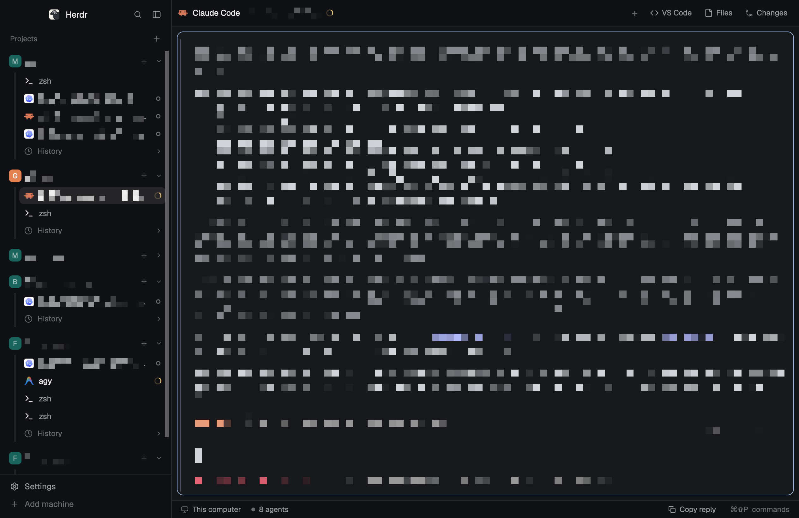

# Herdr Project Tree

A [Herdr](https://herdr.dev) layout: one project → agents tree in the sidebar, agents named
by their session titles, per-project History of past Claude Code / Codex / pi / agy sessions
that resume in one click, a top bar in place of the tab strip, and a "Copy reply" button that
copies the focused agent's latest answer as raw Markdown.



See [RECIPE.md](RECIPE.md) for exactly what it shows and does.

## Install

Copy `layouts/tree.json` and the three folders in `mods/` into `~/.config/herdr-app`, then:

```sh
herdr-app do layout.switch '{"name":"tree"}'
```

`ctrl-shift-l` cycles back to the shipped layout; deleting the files removes it.

Before installing, know that the mods run programs (`python3`, `hc`, `lsof`, `ps`, `pbcopy`)
and read agent session files outside their folder: `~/.claude`, `~/.codex`, `~/.pi`,
`~/.gemini/antigravity-cli`. Nothing reaches the network. Built on Herdr 0.1.18, macOS.
