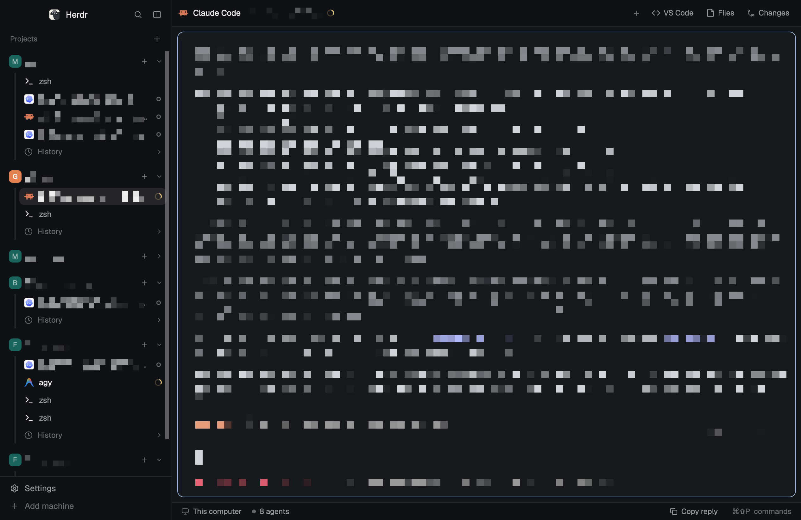

# Project Tree

A Herdr layout whose sidebar is one tree, project → agents, in place of the separate Spaces
and Agents lists. Each project folds on click and lists its agents by their session titles,
then a History node of past Claude Code, Codex, pi and agy sessions that resume in one click.
The tab strip is gone: the top bar names the focused pane, and the bottom bar can copy the
focused agent's latest answer as the raw Markdown it wrote.

## What you see

Left to right: the sidebar (268px, `chrome` background), then the work column.

- **Sidebar**, top to bottom: the shipped `workspace-chrome` brand row (46px); the tree; the
  shipped `workspace-chrome` footer (69px).
- **Tree header** (31px): "Projects" in 11.5px `dim`, and a 26px `+` button (new space).
- **Project row** (32px, radius 8): a 20px avatar (radius 6, white bold 11px initial on the
  space color: `ansi6 #22a99a`, `ansi3 #e3814f`, `ansi4 #5b8def`, `ansi5 #8b7cf6`,
  `ansi2 #3fae6a`, `ansi1 #d9649a`; 55% opacity when inactive), the name in 13.5px semibold
  (`foreground` when active, else `muted`), the branch in 11px `dim` unless main/master, the
  machine name, a `+` (new tab in that space) and a chevron. Folded, it also shows how many
  rows it hides and the most urgent status among them.
- **Children** sit 15px in, behind a 1.5px left rule in the theme's `input` color, so projects
  and agents never look alike.
- **Agent row** (27px, 12.5px text): the program's icon (15px), its label, its status. One row
  per agent pane; a tab without an agent shows its first terminal (terminal icon). The
  focused one has the `selected` background.
- **Sub-agent row** (24px, 12px): `└`, icon, name, status; 14px more indent per depth.
- **History node** (26px, 12px `dim`): clock icon, "History", spinner while loading, chevron.
  Open, it lists sessions (24px rows, 22px indent): agent icon, title in `muted`, age
  (`now`, `5m`, `3h`, `2d`) in 11px `dim`; 15 per page, then "More…".
- **Top bar** (42px, `chrome`, bottom border): the focused pane's icon, name (medium weight,
  max 260px), folder with `~` for home, status (spinner / "Needs you" chip / done dot). Right:
  `+` (new-menu popup), "VS Code" (code icon, opens the pane's folder), Files and Changes
  toggles.
- **Main**: the active tab's panes, 10px radius, 1px `border`, `accent` when focused, 8px gap;
  no per-pane header.
- **Status bar** (28px): machine, branch, agent count and how many need you; on the right
  "Copy reply" (when the focused pane runs an agent) and the command palette hint.

## How it behaves

- **Statuses**: working = 12px spinner in `working`, turning in 900ms; blocked = 14px tile, "!"
  in `blocked` on 15% `blocked`; done = 7px `done` dot; idle = 7px ring in `idle`.
- **Labels**: a name someone gave the pane, then the tab's name, then the running session's
  own title, then the title the program set on its terminal (status glyphs stripped; paths,
  `user@host` and the bare program name ignored), then the program's name. Session titles:
  Claude Code's latest `custom-title` / `ai-title` (else its first prompt), pi's first prompt,
  agy's summary title; Codex already puts its thread name in the terminal title. They refresh
  when any agent's status changes and every 20s, not while the window is hidden.
- **Clicks**: a project row folds or unfolds it (remembered); its `+` opens a tab there; a row
  focuses that pane (`pane.focus`, which also shows its project); a sub-agent peeks
  (`terminal.peek`); right-click a project or row for the shipped menus. A History entry opens a
  new tab in that project and folder running `claude --resume <id>`, `codex resume --no-daemon
  <id>`, `pi --session <id>` or `agy --conversation <id>`. `agent.next` / `agent.prev` follow
  the tree's order.
- **History** matches sessions to the folders the project's terminals are in now (the space's
  creation folder if it has none), newest first, read again each time it opens.
- **Top bar**: hovering the pane info shows split right, split down, zoom and close for that
  pane. "VS Code" runs `open -a "Visual Studio Code" <folder>` (macOS, local spaces only; a
  failure posts an error toast). Files / Changes open the side panel; its state is
  remembered per space.
- **Copy reply** copies the newest run of the agent's answer text (text up to its next tool
  call, so a finished turn's closing answer), reports "Copied N chars" or the error, and resets
  after 2.5s.
- **Narrow sidebar** (< 160px): each project is one 28px initial; click selects the space.

## Built from

- `layouts/tree.json`: a clone of the shipped `main`. `sidebar-lists` holds one block with mod
  `space-tree`; the `tabs` block shows `top-bar`; `status` shows `status-bar`; the `main`
  block's `pane` has no `header`.
- `mods/space-tree` (new): `spaces`, `panes`, `terminals`, `focused`, `run`, `openOverlay`,
  `setAgentOrder`, `shared("space.colors")`, `layout`, `exec`, `appHome`, `window`,
  `localStorage`, `cx.timer.every`, `cx.spawn`. Helpers it runs with `python3 -I`:
  - `sessions.py <limit> <folder>...`: past sessions from `~/.claude/projects`,
    `~/.codex/sessions` (+ `session_index.jsonl` names), `~/.pi/agent/sessions`,
    `~/.gemini/antigravity-cli/conversation_summaries.db`.
  - `live.py <terminal>...`: titles of running sessions. `hc get <t> --json` gives the
    foreground pid and argv. Claude: `~/.claude/sessions/<pid>.json` → session id. pi/Codex:
    the id in argv, else the newest session file written since the process started (`ps -o
    etime=`). agy: the `presence/<id>.lock` (or `conversations/<id>.db`) it holds open (`lsof -p`).
  - `reply.py <terminal>`: the latest answer, put on the clipboard with `pbcopy`.
- `mods/top-bar`: a clone of the shipped `tabs` with the tab strip and wheel switching removed
  and the pane info and VS Code button added (`code.svg` is Lucide's code icon); uses the shipped `pane`, `files`, `changes`, `new-menu` art.
- `mods/status-bar`: a clone of the shipped `workspace-status` plus the Copy reply button;
  `copy.svg` is Lucide's copy icon.

## Watch out

- It reads every agent's private session files: formats change between versions, and a
  change shows up as rows falling back to the program's name, not as an error.
- pi and Codex sessions started fresh (not resumed) are matched by "newest file in that folder
  since the process started": two of them started in one folder can swap titles or answers.
  Claude Code and agy are matched exactly.
- Copy reply is macOS only (`pbcopy`) and doesn't support agy, whose conversations are binary.
- `status-bar` runs `mods/space-tree/reply.py`: renaming `space-tree` breaks Copy reply.
- History also lists a session that is running now; resuming it starts a second copy.
- A space's name follows its first terminal's folder, which can differ from the folder it was
  created in; History therefore matches the terminals' current folders.
- Needs `python3`, `hc` on PATH, `lsof` and `ps`.

## Done when

- `herdr-app check mods/space-tree`, `mods/top-bar` and `mods/status-bar` pass, and
  `layout.switch {"name":"tree"}` shows the tree with no errors in `herdr-app status`.
- Clicking a project name folds it without switching space; clicking a row focuses that pane.
- A running Claude Code row shows its session title, not "Claude Code".
- Opening History lists past sessions of that folder; clicking one opens a tab resuming it.
- With an agent focused, Copy reply puts its last answer on the clipboard with Markdown
  headings and code fences intact.
